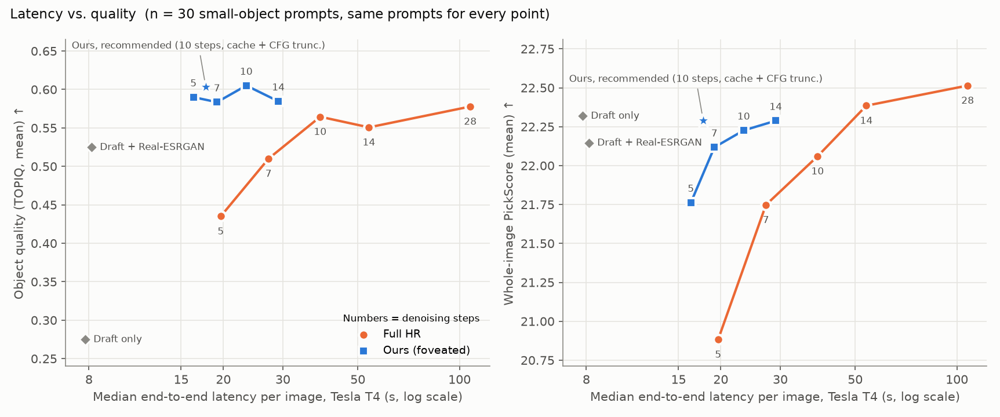
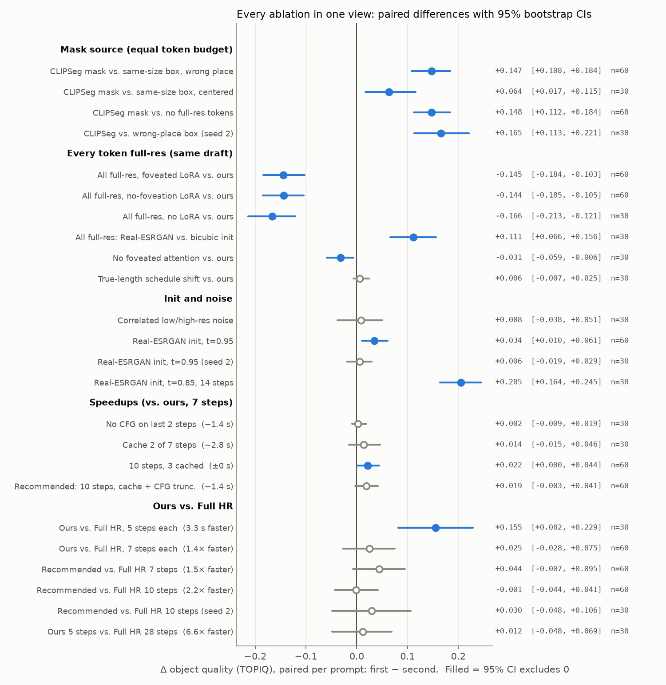
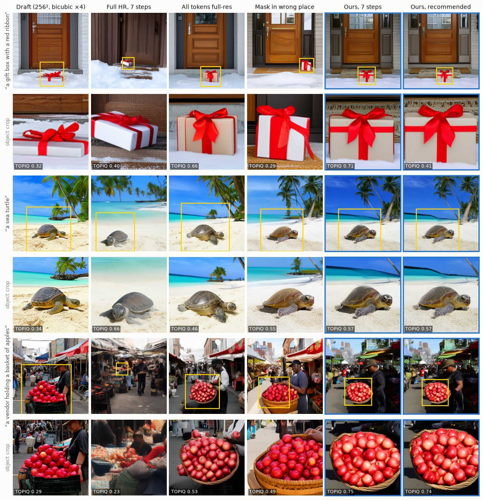

# Ablations: Semantic Foveated Diffusion

This document lists every ablation run in the Session 2 study and what each one showed. The full tables, with every paired confidence interval, are in [RESULTS.md](RESULTS.md) (section "Session 2") and [results/ablations/SUMMARY.md](results/ablations/SUMMARY.md). The raw per-image metrics are in `results/ablations/metrics*.csv`.



*Each point is one configuration, averaged over the same 30 prompts; numbers next to points are denoising steps. Ours (blue) reaches the object quality of Full HR at 10–28 steps (orange) in 16–29 s. On whole-image PickScore, Full HR catches up only at 14+ steps, because ours keeps the background at low resolution.*

## Setup

- **Model:** FLUX.2-klein-base-4B with Foveated Diffusion attention and the `fov_random` LoRA, run in fp16 on one Tesla T4.
- **Latency:** wall-clock on the T4, about 5–8× slower than an RTX 5090. Compare methods by their latency ratios, not by absolute seconds.
- **Pipeline ("ours"):**
  1. Stage 1 makes a 256² draft in 14 steps.
  2. CLIPSeg finds the object and builds a mask on a 32×32 token grid (threshold 0.5, dilated by 2 blocks).
  3. Stage 2 upsamples the draft (bicubic by default), re-noises it to t = 0.95, and refines it with mixed-resolution tokens: full resolution inside the mask, low resolution elsewhere.
- **Prompts:** the small-object benchmark (the object takes up little of the frame). The key comparisons use all n = 60 prompts; the rest use n = 30 (the even ids). A second noise seed was run on 30 prompts.
- **Metrics:**
  - The object is located by OWLv2, a different detector from CLIPSeg (which makes the masks), so the metric is independent of the mask.
  - Object crop: TOPIQ-NR, MUSIQ, CLIP-IQA and high-frequency energy.
  - Whole image: PickScore.
  - `drift_lpips`: LPIPS between the output and the draft at 256², i.e. how faithful the output stays to the draft.
  - `ref_lpips_obj`: LPIPS inside the object box against an all-full-res, no-foveation reference made from the same draft.
  - `seam`: disagreement between the full-res and low-res decodes in a band around the mask border.
- **Statistics:** every comparison is paired per prompt, with 95% bootstrap CIs. ✱ means the CI excludes 0 and n.s. means it does not. There are about 40 comparisons in total, so treat a single marginal ✱ as weak evidence.

## Bottom line

- **Recommended configuration: `ours_cache_cfgoff2_t95_r10`.**
  - Settings: bicubic init, 10 refinement steps, residual cache on steps 3, 5 and 7, and no CFG on the last 2 steps. It takes 17.9 s on the T4.
  - **vs. Full HR 10-step:** it ties on all quality metrics and is 2.2× faster. The tie holds on both seeds.
  - **vs. Full HR 7-step:** it is better on MUSIQ (+4.3 ✱) and PickScore (+0.48 ✱) and 1.5× faster.
- **The gain comes from the mask's placement.** A CLIPSeg mask beats a same-size mask in the wrong place by +0.15 object TOPIQ. A wrong-place mask is no better than no full-res tokens at all.
- **The all-full-res gap is explained.** Making every token full-res gives a worse object because it keeps the blur of the bicubic-upsampled draft. The LoRA and the schedule shift are ruled out as causes.
- **Caveat:** no-reference IQA rewards sharpening. The draft plus Real-ESRGAN, with no diffusion at all, already scores TOPIQ 0.525. A blind human A/B test is still needed before claiming a perceptual win.



*Each row is a paired comparison over the same prompts and draft (first − second), with a 95% bootstrap CI. Filled points have CIs that exclude 0; hollow points are not significant. "Seed 2" rows rerun the comparison with a different noise seed.*

## All ablations

The variant names match `VARIANTS` in [scripts/run_ablations.py](scripts/run_ablations.py). Unless noted, Stage 2 uses t = 0.95, 7 refinement steps, the CLIPSeg mask, bicubic init and independent noise.

### 1. Baselines

| Variant | What it is | n |
|---|---|---|
| `draft` | Stage-1 256² draft only, upscaled for display | 60 |
| `draft_esr` | Draft + Real-ESRGAN ×4, no diffusion | 30 |
| `fhr5`, `fhr7`, `fhr10`, `fhr14`, `fhr28` | Full-resolution generation from scratch at 5/7/10/14/28 steps | 30 (7 and 10 steps: 60) |
| `ours_t95_r7` | Reference configuration of our method | 60 |

### 2. Latency vs. quality curve

| Variant | Change | Latency (T4) | Result |
|---|---|---|---|
| `ours_t95_r5/r7/r10/r14` | 5/7/10/14 refinement steps | 16.3 / 19.2 / 23.6 / 29.1 s | Object quality saturates by 5 steps (TOPIQ 0.590) |
| `ours_t85_r14` | t = 0.85, 14 steps | 29.1 s | Too little noise: keeps the blur (TOPIQ 0.344) |
| `ours_d5_t95_r7` | 5-step draft | 13.7 s | −5.1 s; TOPIQ −0.044 n.s.; drifts further from the draft (+0.070 ✱) |

**Ours vs. Full HR:**

| Steps | n | Object quality | Speed |
|---|---|---|---|
| 5 | 30 | Ours better on all metrics: TOPIQ +0.155 ✱, MUSIQ +13.9 ✱, PickScore +0.88 ✱ | 3.3 s faster |
| 7 | 60 | MUSIQ +4.0 ✱, PickScore +0.32 ✱; TOPIQ +0.025 n.s. | 1.4× faster |
| 10 | 60 | All differences n.s. | 2.6× faster |
| 14 | 30 | All differences n.s. | 1.9× faster |

Ours at 5 steps also ties Full HR at 28 steps on object quality while being 6.6× faster. It loses on whole-image PickScore (−0.75 ✱), as expected, because the background stays at low resolution.

### 3. Mask source at an equal token budget

| Variant | Mask | Δ object TOPIQ vs. ours (n) |
|---|---|---|
| `mask_random_t95_r7` | Box with the same token count, placed away from the object | −0.147 ✱ (60) |
| `mask_center_t95_r7` | Same-size box at the image center | −0.064 ✱ (30) |
| `mask_none_t95_r7` | No full-res tokens | −0.148 ✱ (60) |
| `topk05/25/50_t95_r7` | CLIPSeg top-k at 5% / 25% / 50% of tokens | TOPIQ 0.557 / 0.569 / 0.528 (30) |

- A random mask is no better than no mask: TOPIQ +0.001 n.s.
- The paired reference metric agrees. Inside the object box, the CLIPSeg output is closer to the no-foveation reference than the random-mask output (Δ LPIPS −0.118 ✱).
- Giving more tokens full resolution makes the object *worse*. This is the same blur effect as in section 4.
- The placement result replicates on the second seed: CLIPSeg vs. random mask +0.165 ✱.

### 4. Why is making every token full-res worse?

All variants start from the same draft and noise as ours. Δ object TOPIQ is relative to `ours_t95_r7`.

| Variant | Change | Δ object TOPIQ (n) |
|---|---|---|
| `allhr_fov_t95_r7` | Every token full-res, foveated LoRA | −0.145 ✱ (60) |
| `allhr_nofov_t95_r7` | Every token full-res, no-foveation LoRA | −0.144 ✱ (60) |
| `allhr_base_t95_r7` | Every token full-res, no LoRA | −0.166 ✱ (30) |
| `allhr_fov_esr_t95_r7` | Every token full-res, Real-ESRGAN init | +0.111 ✱ vs. `allhr_fov` (30) |
| `ours_shiftL_t95_r7` | Ours with the schedule shift at its true token length | +0.006 n.s. (30) |
| `naive_t95_r7` | Mixed resolution without foveated attention or LoRA | −0.031 ✱ (30) |

- **Not the LoRA:** the foveated LoRA, the no-foveation LoRA and no LoRA all give the same deficit.
- **Not the schedule shift:** both paths already use the same shift, and the true-length shift changes nothing.
- **Cause: blur from the init.** Starting all-full-res from the Real-ESRGAN upscale recovers most of the gap, and high-frequency energy rises from 4k to 12k.
- **Open question:** ours also starts from bicubic but comes out sharp. The likely reason is that its few full-res tokens get sharpened against the low-res context, but this was not tested.
- **Naive mixed resolution** is worse than ours on all three metrics (MUSIQ −3.8 ✱, PickScore −0.39 ✱). The foveated attention and LoRA earn their keep.

### 5. Correlated low-res / high-res noise

| Variant | Change | Result |
|---|---|---|
| `ours_corr_t95_r7` | Low-res noise is the 2× average-pooled high-res noise | Null: Δ TOPIQ +0.008 n.s., no metric significant (30) |

This null was expected: the full-res and low-res tokens cover disjoint regions, so correlating their noise only reseeds.

### 6. Real-ESRGAN on the draft before re-encoding

| Variant | Change | Result vs. matching bicubic run |
|---|---|---|
| `ours_esr_t95_r7` | ESRGAN init, t = 0.95 | TOPIQ +0.034 ✱ (60), but **does not replicate** on seed 1 (+0.006 n.s.); +0.46 s |
| `ours_esr_t90_r7`, `ours_esr_t85_r7` | ESRGAN init, t = 0.90 / 0.85 | Much closer to the draft (drift −0.10 / −0.17 ✱), TOPIQ n.s. (30) |
| `ours_esr_t85_r14` | ESRGAN init, t = 0.85, 14 steps | TOPIQ +0.205 ✱, MUSIQ +18.4 ✱: fixes weak refinement (30) |
| `ours_esr_cache_cfgoff2_t95_r10` | ESRGAN + best speed config | No gain over the bicubic version (+0.008 n.s.), PickScore −0.13 ✱ (60) |

**Takeaway:** Real-ESRGAN is useful only when the refinement is weak (low t), or when staying faithful to the draft's layout matters. At t = 0.95 it adds nothing reliable.

### 7. Speedups: CFG truncation and residual caching

The residual cache skips the transformer on the listed steps and reuses the stored residual, as in TeaCache or FORA.

| Variant | Change | Δ latency | Quality vs. `ours_t95_r7` |
|---|---|---|---|
| `ours_cfgoff2_t95_r7` | No CFG on the last 2 steps | −1.4 s | TOPIQ n.s., PickScore −0.04 ✱ (30) |
| `ours_cache_t95_r7` | Cache steps 3 and 5 | −2.8 s | TOPIQ n.s., PickScore −0.17 ✱ (30) |
| `ours_cache_t95_r10` | 10 steps, cache steps 3, 5, 7 | ±0 s | TOPIQ +0.022 ✱, PickScore +0.17 ✱ (60); replicates on seed 1 |
| `ours_cache_cfgoff2_t95_r10` | Above + no CFG on the last 2 steps | −1.45 s | TOPIQ +0.019 n.s., PickScore +0.16 ✱ (60) — **recommended** |
| `fhr7_cfgoff2`, `fhr10_cache`, `fhr14_cache` | The same speedups applied to Full HR | — | Ours + cache still beats Full HR + cache at equal steps (TOPIQ +0.075 ✱) |

### 8. Second seed (robustness)

These comparisons were rerun on 30 prompts with a different noise seed.

- **Replicate:** mask placement, the all-full-res deficit, the 10-step cache gain, and the best configuration's tie with Full HR 10-step (TOPIQ +0.030 n.s., 20.8 s faster).
- **Do not replicate:** the Real-ESRGAN gain at t = 0.95.

## Not done / open

- Blind human A/B preference test. No-reference IQA rewards sharpening, so a perceptual-quality claim still needs this.
- Three resolution levels (stretch goal).
- A distilled or few-step draft model. Even the fastest setting here takes 13.7 s on the T4, so the sub-3-second regime can only be checked on the faster GPU.
- Direct test of why few full-res tokens come out sharp while all full-res tokens stay blurry.

## Reproduce

```bash
source env.sh
$PY scripts/encode_prompts.py                 # cache text embeddings (one-time)
bash scripts/run_all.sh                       # all phases: generate -> evaluate -> summarize (resumable)
# or a single variant set:
$PY scripts/run_ablations.py --variants ours_t95_r7 fhr7 --subset 30 --out outputs/abl
$PY scripts/eval_ablations.py --root outputs/abl
$PY scripts/summarize_ablations.py            # tables -> results/ablations/SUMMARY.md + RESULTS.md, figures -> assets/
```

| File | Role |
|---|---|
| [src/semantic_foveation/ablation.py](src/semantic_foveation/ablation.py) | `AblationPipeline`, which carries every knob: init, noise, cache, CFG truncation, LoRA mode, mask |
| [src/diffsynth_fov/dit.py](src/diffsynth_fov/dit.py) | Residual-cache hook in `Flux2DiTFoveated.forward` |
| [scripts/run_ablations.py](scripts/run_ablations.py) | Variant registry and generation |
| [scripts/eval_ablations.py](scripts/eval_ablations.py) | Metrics |
| [scripts/summarize_ablations.py](scripts/summarize_ablations.py) | Paired-bootstrap tables and plot |
| [scripts/ablation_figure.py](scripts/ablation_figure.py) | Figures: latency vs. quality, paired-effects plot, qualitative grid |
| [scripts/run_all.sh](scripts/run_all.sh), [scripts/extra_phases.sh](scripts/extra_phases.sh) | Phase driver |

## Qualitative examples



*Three prompts at the 25th, 50th and 75th percentile of the ours-vs-all-full-res TOPIQ gap, chosen by that rule rather than by eye. Top of each pair: the full image with the OWLv2 object box. Bottom: the crop that box defines, which is what TOPIQ scores. All columns except Full HR share the same draft. Note that TOPIQ can differ a lot between near-identical crops (gift box: 0.71 vs. 0.41), which is why the claims rest on paired averages over many prompts rather than on single images.*
