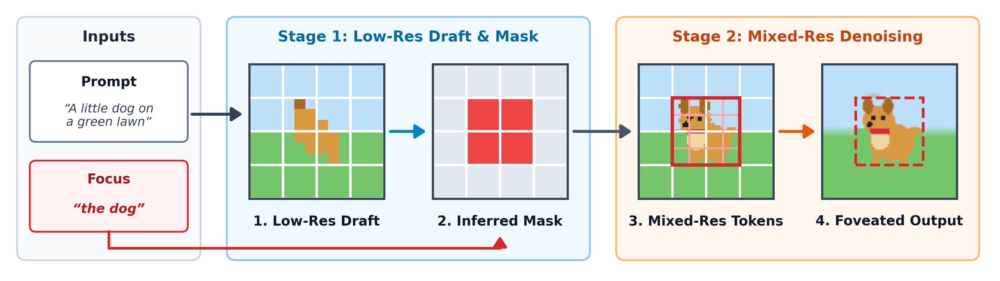

# Semantic Foveated Diffusion

A two-stage, text-guided mixed-resolution **image generation** pipeline built on [Foveated Diffusion](https://arxiv.org/abs/2603.23491) ([`bchao1/foveated_diffusion`](https://github.com/bchao1/foveated_diffusion)).

Standard Foveated Diffusion needs a pre-specified resolution mask (a fixed circle or a gaze point). **Semantic Foveated Diffusion** infers *where* to spend high-resolution tokens from a cheap low-resolution draft and a text description of what matters.



## Method

**Inputs:** a scene prompt (*"a wide snowy mountain landscape, a skier in a red jacket…"*) and a focus prompt (*"a skier in a red jacket"*).

1. **Stage 1 (draft):** generate a 256² draft (16×16 = 256 tokens, 14 steps) with FLUX.2-klein-base-4B.
2. **Mask:** run CLIPSeg (`CIDAS/clipseg-rd64-refined`) on the draft and focus prompt. Threshold the heatmap at 0.5 and dilate by 2 blocks to get a block-aligned mask on the 32×32 token grid.
3. **Stage 2 (foveated refinement):**
   - VAE-encode the upsampled draft. Keep full-resolution tokens inside the mask and ½-resolution tokens outside: $L = m + (4096 - m)/4$ tokens.
   - Re-noise to $t = 0.85$ and denoise in 14 steps with Foveated Diffusion's CRPA attention and pretrained `fov_random` LoRA.
   - Decode both resolutions and blend with a smoothed mask.

## Results

The method is 3.4× faster than full 1024² generation end to end for small subjects (3.7 s vs 12.6 s on an RTX 5090), and about 2.3× faster for large foreground subjects on plain backgrounds. The focus object is much sharper than the low-res draft, but full-resolution generation is still more detailed. See [**RESULTS.md**](RESULTS.md).

## Repository structure

```text
├── src/
│   ├── diffsynth_fov/            # Foveated FLUX.2 DiT (CRPA attention) & pipeline (from upstream)
│   ├── masks/                    # Geometric mask primitives (from upstream)
│   └── semantic_foveation/
│       ├── pipeline.py           # Stage 1 draft, Stage 2 foveated refinement, full-HR baseline
│       ├── localizer.py          # CLIPSeg heatmap -> block-aligned foveation mask
│       ├── benchmark.py          # Small-object (60) and large-subject (12) prompt sets
│       └── metrics.py            # Focus-crop CLIP-IQA, HF energy, CLIP score
├── scripts/
│   ├── infer_semantic_foveation.py   # Single-prompt inference
│   ├── run_benchmark.py              # Quality benchmark (all methods, 60 prompts)
│   ├── run_timing.py                 # Repeated latency measurement
│   ├── ablation_negative_prompt.py   # Negative prompt x t_switch ablation
│   ├── generate_results_figures.py   # Qualitative figure
│   └── generate_method_figure.py     # Method diagram
├── data/                             # small_object_benchmark_60.csv, large_subject_12.csv
├── results/                          # per-prompt metrics and timing CSVs
└── RESULTS.md
```

## Quick start

```bash
python scripts/infer_semantic_foveation.py \
  --prompt "A wide snowy mountain landscape, a skier in a red jacket descending the slope in the distance" \
  --focus_prompt "a skier in a red jacket" \
  --output_dir outputs/demo_skier

python scripts/run_benchmark.py --device cuda:0
python scripts/run_benchmark.py --prompt_set large --t_switch 0.95 --device cuda:0
python scripts/run_timing.py --device cuda:0
python scripts/generate_results_figures.py --ids 31 15 47
python scripts/generate_results_figures.py --metrics_csv results/large_subject_metrics.csv \
  --ids 101 103 100 --crop_side 320 --out assets/large_subject_comparison.png
```
