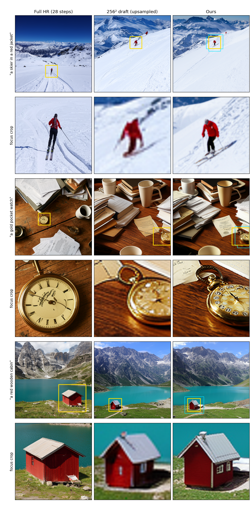

# Results

**Semantic Foveated Diffusion generates a 1024² image 3.4× faster than full-resolution generation (3.7 s vs 12.6 s, all stages included). The focus object is clearly sharper than in the low-res draft, but still less detailed than in full-resolution generation.**

## Setup

- **Model:** FLUX.2-klein-base-4B with the pretrained Foveated Diffusion `fov_random` LoRA (no training). CFG 4, with the negative prompt "blurry, out of focus, low resolution, …" for all methods.
- **Benchmark:** 60 wide scenes, each with one small object that matters (15 each of animals, objects, people, structures), e.g. *"a wide snowy mountain landscape, a skier in a red jacket…"* with focus prompt *"a skier in a red jacket"*. See `data/small_object_benchmark_60.csv`.
- **Methods:**

| Method | What it does |
|---|---|
| **Full HR** (main baseline) | Standard 1024² generation, 28 steps, 4096 tokens |
| **Low-res draft** | Stage 1 only: 256² draft (14 steps, 256 tokens), bicubic-upsampled |
| **Ours** | Draft → CLIPSeg mask (threshold 0.5, dilated 2 blocks) → foveated Stage 2 from t=0.85 (14 steps): full-res tokens in the mask, ½-res tokens elsewhere |
| Naive mixed-res (ablation) | Ours without the Foveated LoRA, i.e. tests the original Foveated Diffusion training |

- **Focus-region metrics.** Each image gets a square crop around the focus object, found by CLIPSeg on that image. Full HR needs its own crop because it has a different composition.
  - *CLIP-IQA*: probability that CLIP prefers "a sharp, detailed photo" over "a blurry, low-resolution photo".
  - *HF energy*: mean squared Laplacian, a measure of fine detail.
  - *Focus CLIP*: similarity between the crop and the focus prompt, i.e. whether the object is still correct.
- **Latency:** wall-clock on one idle RTX 5090, median of 5 runs × 5 prompts, counting every stage (draft, mask, Stage 2, VAE encode and decode).

## Main results

| Method | Latency | Speedup | Stage-2 tokens | Focus CLIP-IQA ↑ | Focus HF energy ↑ | Focus CLIP ↑ |
|---|---|---|---|---|---|---|
| Full HR | 12.57 s | 1.0× | 4096 | **0.57** | **16.6k** | 29.9 |
| Low-res draft | 1.01 s | 12.4× | – | 0.38 | 0.6k | 29.3 |
| **Ours** | **3.73 s** | **3.4×** | 1374 (median) | 0.46 | 2.1k | 29.9 |
| Naive mixed-res | ≈3.7 s | ≈3.4× | 1374 | 0.40 | 2.1k | 30.2 |

Ours' latency breaks down as a 1.01 s draft, a 0.01 s mask, and a 2.71 s Stage 2. The mask covers a median of 11% of the image.

**Paired comparisons (fraction of the 60 prompts where ours scores higher):**

| Ours vs. | CLIP-IQA | HF energy |
|---|---|---|
| Low-res draft | 70% | 95% |
| Naive mixed-res | 75% | 48% |
| Full HR | 35% | 0% |

## Qualitative comparison

Each example shows a row of full images, then a row of zoomed crops of the focus object. Yellow boxes mark the crop; the cyan outline on *Ours* marks the full-resolution token region.

## Takeaways

- **Speed:** 3.4× faster than full HR end-to-end. Stage 2 dominates the cost; CLIPSeg is negligible.
- **Quality vs. the draft:** Stage 2 adds real detail to the focus object, such as the skier's limbs and poles and the watch's numerals.
- **Quality vs. full HR:** full HR is still clearly sharper (about 8× higher HF energy). Stage 2 starts from a blurry 256² draft and only re-noises to t=0.85, so it cannot fully recover high-frequency detail. The object is semantically just as correct (focus CLIP is equal).
- **Foveated LoRA vs. naive:** similar fine detail, but crops from the LoRA look less blurry to CLIP-IQA on 75% of prompts.
- **Failure mode:** when CLIPSeg misses the object (e.g. a mountain goat in a rocky slope), the mask spreads over a large area. That example took 75% of the image, which costs speed and doesn't help the object.

## Design choices

- **`t_switch = 0.85`:** below this, Stage 2 barely changes the draft; at 0.9 and above, the object's content drifts (e.g. the pocket watch turned into a different object).
- **Negative prompt:** without it, Stage 2 keeps the draft's blur. On 4 test prompts, it raised ours' focus HF energy from 0.8k to 4.9k (`scripts/ablation_negative_prompt.py`).

Raw numbers: `results/benchmark_metrics.csv` (per prompt) and `results/timing.csv`.
