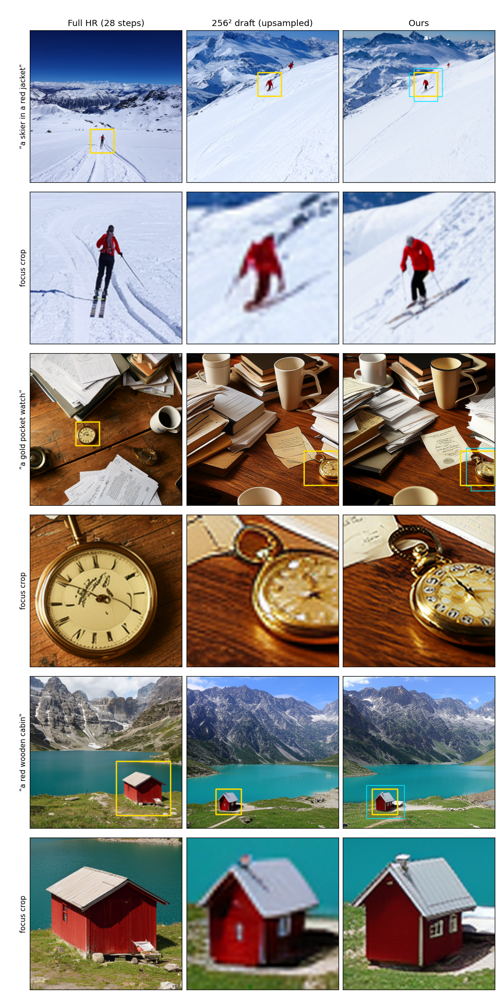
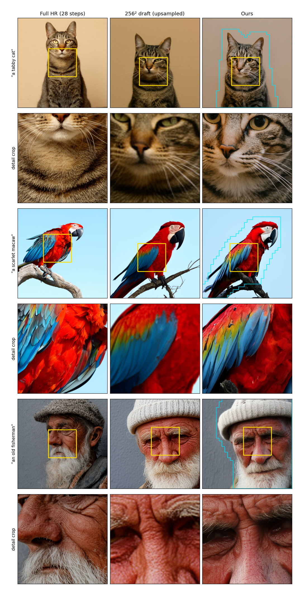
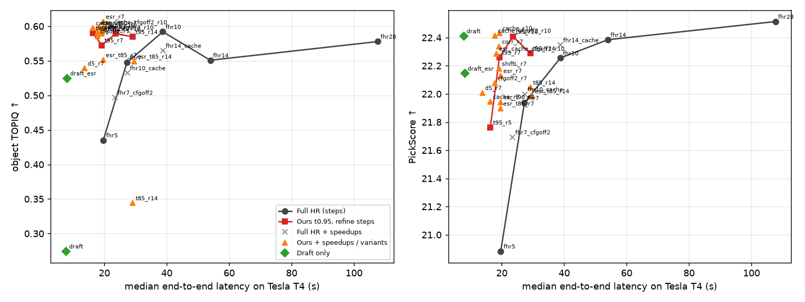
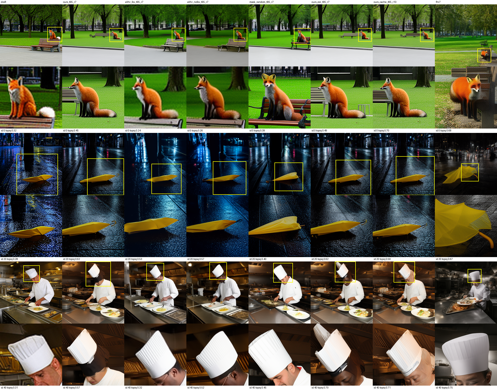

# Results

**Semantic Foveated Diffusion generates a 1024² image 3.4× faster than full-resolution generation for small subjects (3.7 s vs 12.6 s, all stages included), and about 2.3× faster for large foreground subjects. The focus region is clearly sharper than in the low-res draft, but still less detailed than in full-resolution generation.**

## Setup

- **Model:** FLUX.2-klein-base-4B with the pretrained Foveated Diffusion `fov_random` LoRA (no training). CFG 4, with the negative prompt "blurry, out of focus, low resolution, …" for all methods.
- **Benchmarks:**
  - *Small objects (main):* 60 wide scenes, each with one small object that matters (15 each of animals, objects, people, structures), e.g. *"a wide snowy mountain landscape, a skier in a red jacket…"* with focus prompt *"a skier in a red jacket"*. See `data/small_object_benchmark_60.csv`.
  - *Large subjects:* 12 close-ups where the subject fills much of the frame against a plain background (portrait, cat, macaw, …). See `data/large_subject_12.csv`.
- **Methods:**

| Method | What it does |
|---|---|
| **Full HR** (main baseline) | Standard 1024² generation, 28 steps, 4096 tokens |
| **Low-res draft** | Stage 1 only: 256² draft (14 steps, 256 tokens), bicubic-upsampled |
| **Ours** | Draft → CLIPSeg mask (threshold 0.5, dilated 2 blocks) → foveated Stage 2 from t=0.85, or 0.95 for large subjects (14 steps): full-res tokens in the mask, ½-res tokens elsewhere |
| Naive mixed-res (ablation) | Ours without the Foveated LoRA, i.e. tests the original Foveated Diffusion training |

- **Focus-region metrics.** Each image gets a square crop around the focus object, found by CLIPSeg on that image. Full HR needs its own crop because it has a different composition.
  - *CLIP-IQA*: probability that CLIP prefers "a sharp, detailed photo" over "a blurry, low-resolution photo".
  - *HF energy*: mean squared Laplacian, a measure of fine detail.
  - *Focus CLIP*: similarity between the crop and the focus prompt, i.e. whether the object is still correct.
- **Latency:** wall-clock on one idle RTX 5090, median of 5 runs × 5 prompts, counting every stage (draft, mask, Stage 2, VAE encode and decode).

## Small objects (main benchmark)

| Method | Latency | Speedup | Stage-2 tokens | Focus CLIP-IQA ↑ | Focus HF energy ↑ | Focus CLIP ↑ |
|---|---|---|---|---|---|---|
| Full HR | 12.57 s | 1.0× | 4096 | **0.57** | **16.6k** | 29.9 |
| Low-res draft | 1.01 s | 12.4× | – | 0.38 | 0.6k | 29.3 |
| **Ours** | **3.73 s** | **3.4×** | 1374 (median) | 0.46 | 2.1k | 29.9 |
| Naive mixed-res | ≈3.7 s | ≈3.4× | 1374 | 0.40 | 2.1k | 30.2 |

Ours' latency breaks down as a 1.01 s draft, a 0.01 s mask, and a 2.71 s Stage 2. The mask covers a median of 11% of the image.

**Paired comparisons (fraction of the 60 prompts where ours scores higher):**

| Ours vs. | CLIP-IQA | HF energy |
|---|---|---|
| Low-res draft | 70% | 95% |
| Naive mixed-res | 75% | 48% |
| Full HR | 35% | 0% |

Each example shows a row of full images, then a row of zoomed crops of the focus object. Yellow boxes mark the crop; the cyan outline on *Ours* marks the full-resolution token region.

## Large foreground subjects

The mask now covers a median of 54% of the image (2695 Stage-2 tokens), so less is saved. These runs use `t_switch = 0.95`; at 0.85, Stage 2 added no detail to large subjects (focus HF energy 0.20k vs 0.20k for the draft).

| Method | Latency (est.) | Speedup | Focus HF energy ↑ | Focus CLIP-IQA |
|---|---|---|---|---|
| Full HR | 12.57 s | 1.0× | **6.7k** | 0.58 |
| Low-res draft | 1.01 s | 12.4× | 0.2k | 0.64 |
| **Ours** | **≈5.6 s** | **≈2.3×** | 2.4k | 0.57 |
| Naive mixed-res | ≈5.6 s | ≈2.3× | 1.8k | 0.53 |

- Ours has more fine detail than the draft on 12/12 prompts and more than naive on 9/12.
- Latency is estimated, because the GPU was shared during these runs. Per-step cost is linear in token count across the three clean measurements (256, 1374 and 4096 tokens, within 6%), and the estimate applies that to the median token count. It ranges from ≈2.0× (76% mask) to ≈3.0× (24% mask).
- CLIP-IQA is not reliable on these large, smooth crops: it rates the blurry draft highest.

Zoomed crops here are 320 px detail crops at the subject center, since the whole subject spans most of the image.

## Takeaways

- **Speed:** 3.4× faster than full HR for small objects, ≈2.3× for large subjects. The saving scales with how much of the image the background takes up. Stage 2 dominates the cost; CLIPSeg is negligible.
- **Quality vs. the draft:** Stage 2 adds real detail to the focus region: the skier's limbs and poles, the watch's numerals, cat fur, and macaw feathers. Plain backgrounds look fine at ½ resolution.
- **Quality vs. full HR:** full HR is still clearly sharper (about 8× higher HF energy). Stage 2 starts from a blurry 256² draft and only partially re-noises it, so it cannot fully recover high-frequency detail. The object is semantically just as correct (focus CLIP is equal).
- **Foveated LoRA vs. naive:** similar fine detail, but crops from the LoRA look less blurry to CLIP-IQA on 75% of prompts.
- **Failure mode:** when CLIPSeg misses the object (e.g. a mountain goat in a rocky slope), the mask spreads over a large area. That example took 75% of the image, which costs speed and doesn't help the object.

## Design choices

- **`t_switch` depends on subject size:**
  - *Small objects use 0.85.* At 0.9 and above, the object's content drifts (e.g. the pocket watch turned into a different object).
  - *Large subjects need 0.95.* Their structure is already fixed in the draft, so lower values only reproduce its blur.
  - A simple automatic rule would pick `t_switch` from the mask area.
- **Negative prompt:** without it, Stage 2 keeps the draft's blur. On 4 test prompts, it raised ours' focus HF energy from 0.8k to 4.9k (`scripts/ablation_negative_prompt.py`).

Raw numbers: `results/benchmark_metrics.csv`, `results/large_subject_metrics.csv` (per prompt), and `results/timing.csv`.

---

# Session 2: ablations on a Tesla T4

These experiments follow up on session 1 (t_switch 0.95 and 7 refinement steps as the recommended setting). They test the questions it left open:
1. Why does giving every token full resolution score worse than foveating?
2. Does the CLIPSeg mask matter, or would any mask with the same token budget do as well?
3. Do correlated low-res and high-res noise help?
4. Does Real-ESRGAN on the draft help, compared with bicubic upsampling?
5. Do CFG truncation and residual caching speed things up, applied to Full HR too for fairness?
6. Where does the method sit on the latency-quality curve?
7. What do paired metrics show, instead of comparing unrelated crops?

**Setup differences from session 1:**
- **Hardware:** one Tesla T4 with fp16, because bf16 is emulated on Turing. Absolute latencies are about 5–8× those on the RTX 5090. Only the ratios carry over.
- **Prompt embeddings:** cached once with the bf16 text encoder (`scripts/encode_prompts.py`).
- **Object crops:** found by OWLv2 on each output image, independent of the CLIPSeg masks.
- **Quality metrics:** TOPIQ-NR and MUSIQ on the crop, PickScore on the whole image, plus the repo's CLIP-IQA and HF energy.
- **Paired metrics:** every comparison is paired per prompt with a 95% bootstrap CI.
- **Draft faithfulness (`drift_lpips`):** LPIPS between the output downsized to 256² and the draft.
- **Foveation cost (`ref_lpips_obj`):** LPIPS against a same-draft, same-noise, all-full-res reference inside a shared object box.
- **Seam:** disagreement between the high-res and low-res decodes within 24 px of the mask border.
- **Prompts:** 30 small-object prompts (every second one), extended to 60 and a second seed for the key comparisons.
- **How to run:** `scripts/run_all.sh` runs everything resumably. Variants are defined in `scripts/run_ablations.py`.

## Findings

<!-- ANALYSIS:BEGIN -->
*After all planned phases (seed 0, plus a second seed on 30 prompts, table F; including a follow-up second-seed check of the best config vs. Full HR 10-step). The key comparisons use all n = 60 small-object prompts; the others use n = 30 (the even ids), and each bullet gives its n. Δ values are paired means with 95% bootstrap CIs; ✱ means the CI excludes 0. Latency is measured on a Tesla T4 in fp16, not on an RTX 5090, so only the ratios between methods carry over. There are about 40 comparisons below. A single marginal ✱ (CI barely excluding 0) should be read as weak evidence. Table A mixes n = 30 and n = 60 rows, so compare its absolute means only within the same n; use the paired tables.*

- **Latency-quality curve: ours matches Full HR on object quality at much lower latency, but does not clearly beat it at equal steps (n = 60).**
  - At 7 steps (ours vs. Full HR, n = 60): Δ TOPIQ +0.025 [−0.024, +0.077] n.s., MUSIQ +4.0 ✱, PickScore +0.32 ✱, and 7.6 s faster (19.2 vs. 27.2 s). At n = 30 the TOPIQ gain was +0.073 n.s.; with more prompts it shrank, so there is no object-TOPIQ win at 7 steps.
  - At 10 steps (n = 60): all quality differences are n.s. (TOPIQ −0.003, MUSIQ +0.3, PickScore +0.15), and ours is 14.6 s faster (2.6×).
  - At 5 steps (n = 30) ours wins clearly: Δ TOPIQ +0.155 ✱, MUSIQ +13.9 ✱, PickScore +0.88 ✱. At 14 steps (n = 30) there is no significant difference, and ours is 1.9× faster.
  - Against Full HR at 28 steps (107.6 s, n = 30), ours with 5 steps ties on object quality (TOPIQ +0.012, MUSIQ −1.2, both n.s.) at 6.6× lower latency. It loses on whole-image PickScore (−0.75 ✱); ours with 10 steps narrows that gap to −0.29 ✱. This is expected, since ours keeps the background at low resolution.
- **Mask source at equal token budget: the gain comes from where the mask is, not from its size (n = 60, holds).**
  - The CLIPSeg mask beats a same-size box in the wrong place by Δ TOPIQ +0.147 [+0.107, +0.186] ✱ (MUSIQ +11.5 ✱). It beats no high-res tokens at all by +0.148 ✱.
  - A box in the wrong place is no better than no high-res tokens (TOPIQ +0.001, n.s.).
  - A centered box (n = 30) is in between: CLIPSeg beats it by +0.064 ✱.
  - The paired metric agrees: inside the object box, CLIPSeg output is closer to the no-foveation reference than wrong-place output (Δ LPIPS −0.118 ✱).
  - Token-budget sweep (n = 30): more high-res tokens than the CLIPSeg mask *lowers* object TOPIQ (top-k 25%: 0.569, 50%: 0.528, all: 0.428). This is the same blur effect as the next bullet.
- **Why every-token-full-res is worse: it inherits the blurry bicubic-upsampled draft. The LoRA is not the cause (n = 60, holds).**
  - With the same draft and noise, all-HR is lower than ours by Δ TOPIQ −0.145 [−0.183, −0.104] ✱. The no-foveation LoRA gives the same result (−0.144 ✱), and so does no LoRA (n = 30, −0.166 ✱).
  - The no-foveation and foveated LoRAs tie on object quality (Δ +0.000, n.s.). The no-foveation LoRA scores slightly lower on PickScore (−0.18 ✱).
  - The schedule shift has no effect (n = 30, Δ +0.006, n.s.).
  - Starting all-HR from the Real-ESRGAN upscale instead of the bicubic one recovers most of the gap (n = 30): Δ +0.111 ✱. It also lifts high-frequency energy from 4.2k to 12.0k, matching ours.
  - Open question: ours is also started from bicubic, but is not blurry. The likely reason is that with only about 1.3k high-res tokens attending to low-res context, the model sharpens the object region. This has not been tested directly.
- **Correlated low/high-res noise: null result, as predicted** (the two token sets are disjoint). n = 30: Δ TOPIQ +0.008 [−0.036, +0.049]; no metric is significant.
- **Real-ESRGAN draft upscaling: at t = 0.95 the gain is small and fragile; it only matters when refinement is weak.**
  - At t = 0.95, 7 steps (seed 0, n = 60): Δ TOPIQ +0.034 [+0.010, +0.061] ✱ for +0.46 s, with a small PickScore cost (−0.13 ✱). Against Full HR 7-step it was the only plain variant with a significant TOPIQ win (+0.059 ✱).
  - It **does not replicate on the second seed** (n = 30): Δ TOPIQ +0.006 [−0.018, +0.029] n.s. It also **adds nothing on top of cache + CFG truncation** (n = 60): Δ TOPIQ +0.008 [−0.018, +0.032] n.s., PickScore −0.13 ✱, +0.41 s. Treat the t = 0.95 gain as not established.
  - When refinement is weak (n = 30, t = 0.85, 14 steps) it fixes the otherwise blurry result: TOPIQ +0.205 ✱, MUSIQ +18.4 ✱.
  - Real-ESRGAN at t = 0.85–0.90 stays much closer to the draft (drift LPIPS −0.10 to −0.17 ✱) with no significant TOPIQ loss. This is the setting to use when layout faithfulness matters.
  - **Caveat:** draft + Real-ESRGAN with no diffusion at all already scores TOPIQ 0.525 / MUSIQ 59.7. No-reference IQA on the crop rewards super-resolution-style sharpening, so these scores measure sharpness, not faithfulness or realism. A blind human A/B test is needed before claiming a perceptual win.
- **Speedups (CFG truncation, residual caching): close to free.**
  - Dropping CFG on the last 2 steps (n = 30) saves 1.4 s (−7%). TOPIQ is unchanged; PickScore drops by −0.04 ✱.
  - Caching 2 of 7 steps (n = 30) saves 2.8 s (−15%), with a PickScore cost (−0.17 ✱).
  - Best use (n = 60): 10 steps with 3 cached. That has the same latency as plain 7 steps (Δ +0.03 s, n.s.) but scores better on TOPIQ (+0.022 ✱, marginal), PickScore (+0.17 ✱) and drift (−0.012 ✱). The TOPIQ gain replicates on seed 1 (n = 30, +0.026 ✱, PickScore +0.20 ✱). Adding CFG truncation on top (n = 60) saves 1.45 s vs. plain 7 steps; TOPIQ +0.019 [−0.003, +0.040] n.s., PickScore +0.16 ✱.
  - Applying the same speedups to Full HR does not change the ranking (n = 30): ours + cache beats Full HR + cache at equal steps (Δ TOPIQ +0.075 ✱).
- **Cheaper draft (5 instead of 14 steps, n = 30):** saves 5.1 s. Object quality drops slightly (TOPIQ −0.044, n.s.) and the result drifts further from the draft (+0.070 ✱). It still beats Full HR 5-step by +0.104 ✱ while 5.6 s faster. Even so, the fastest end-to-end setting is 13.7 s on the T4, so the sub-3-second regime needs the faster GPU.
- **Naive mixed resolution (no foveated attention/LoRA, n = 30)** is worse than ours: TOPIQ −0.031 ✱, MUSIQ −3.8 ✱, PickScore −0.39 ✱.
- **Best config (n = 60): `ours_cache_cfgoff2_t95_r10` (bicubic init, 10 steps, 3 cached, no CFG on the last 2), 17.9 s on the T4.**
  - vs. Full HR 7-step: 9.0 s faster (1.5×); TOPIQ +0.044 [−0.006, +0.095] n.s., MUSIQ +4.3 ✱, PickScore +0.48 ✱.
  - vs. Full HR 10-step: 20.5 s faster (2.2×); TOPIQ −0.001 [−0.043, +0.040], MUSIQ +0.2, PickScore +0.16 [−0.04, +0.37], all n.s. That is a tie at equal steps, not a win; at the observed CIs a TOPIQ difference larger than about ±0.04 is unlikely.
  - Adding Real-ESRGAN init (`best60`) gives a slightly higher TOPIQ vs. Full HR 7-step (+0.051 ✱), but the direct paired comparison shows no gain over the bicubic config (see the Real-ESRGAN bullet), so the simpler config is preferred.
- **Second seed (n = 30, table F): the structural findings replicate; the small effects partly do not.**
  - Replicate: CLIPSeg vs. wrong-place mask +0.165 ✱; ours vs. all-HR +0.163 ✱; ours vs. Full HR 7-step TOPIQ +0.039 n.s. with PickScore +0.47 ✱ (same pattern as seed 0); 10-step cache vs. 7-step +0.026 ✱.
  - Do not replicate: Real-ESRGAN at t = 0.95 (+0.006 n.s.).
  - Best config on seed 1 (`seed1b`): the tie with Full HR 10-step holds (TOPIQ +0.030 [−0.042, +0.106], MUSIQ +2.0, PickScore +0.08, all n.s.) at 20.8 s lower latency. Against Full HR 7-step it wins (TOPIQ +0.069 ✱ marginal, PickScore +0.66 ✱).
<!-- ANALYSIS:END -->

## Tables (auto-generated)

<!-- ABLATIONS:BEGIN -->
<!-- generated by scripts/summarize_ablations.py; do not edit by hand -->
### A. Latency vs. quality (all variants, means; latency and tokens are medians)

| Variant | n | latency_s | tokens | obj_topiq | obj_musiq | obj_clipiqa | obj_hf | owl_score | pick | drift_lpips |
|---|---|---|---|---|---|---|---|---|---|---|
| `draft` | 60 | 7.8 | 0 | 0.274 | 29.85 | 0.376 | 0.6k | 0.630 | 22.41 | – |
| `draft_esr` | 30 | 8.1 | 0 | 0.525 | 59.72 | 0.591 | 10.8k | 0.550 | 22.15 | – |
| `fhr5` | 30 | 19.6 | 4096 | 0.435 | 46.75 | 0.335 | 25.1k | 0.500 | 20.88 | – |
| `fhr7` | 60 | 27.2 | 4096 | 0.547 | 56.81 | 0.488 | 18.1k | 0.538 | 21.94 | – |
| `fhr10` | 60 | 38.7 | 4096 | 0.592 | 60.94 | 0.531 | 17.9k | 0.574 | 22.25 | – |
| `fhr14` | 30 | 53.9 | 4096 | 0.551 | 61.02 | 0.502 | 21.9k | 0.580 | 22.38 | – |
| `fhr28` | 30 | 107.6 | 4096 | 0.578 | 61.83 | 0.483 | 20.5k | 0.595 | 22.51 | – |
| `fhr7_cfgoff2` | 30 | 23.4 | 4096 | 0.497 | 54.10 | 0.437 | 23.2k | 0.506 | 21.69 | – |
| `fhr10_cache` | 30 | 27.3 | 4096 | 0.532 | 58.53 | 0.481 | 23.8k | 0.545 | 22.00 | – |
| `fhr14_cache` | 30 | 38.8 | 4096 | 0.565 | 61.77 | 0.525 | 23.4k | 0.574 | 22.35 | – |
| `ours_t85_r14` | 30 | 29.1 | 1326 | 0.344 | 42.33 | 0.434 | 1.9k | 0.615 | 22.05 | 0.226 |
| `ours_t95_r5` | 30 | 16.3 | 1326 | 0.590 | 60.65 | 0.563 | 12.2k | 0.593 | 21.76 | 0.461 |
| `ours_t95_r7` | 60 | 19.2 | 1344 | 0.572 | 60.82 | 0.553 | 10.9k | 0.618 | 22.26 | 0.428 |
| `ours_t95_r10` | 60 | 23.6 | 1344 | 0.589 | 61.26 | 0.539 | 10.4k | 0.635 | 22.41 | 0.422 |
| `ours_t95_r14` | 30 | 29.1 | 1326 | 0.585 | 60.64 | 0.555 | 11.6k | 0.623 | 22.29 | 0.431 |
| `ours_d5_t95_r7` | 30 | 13.7 | 1285 | 0.539 | 58.88 | 0.542 | 13.6k | 0.567 | 22.01 | 0.512 |
| `ours_cfgoff2_t95_r7` | 30 | 17.8 | 1326 | 0.586 | 60.69 | 0.556 | 11.9k | 0.602 | 22.08 | 0.444 |
| `ours_cache_t95_r7` | 30 | 16.3 | 1326 | 0.597 | 59.78 | 0.523 | 12.3k | 0.622 | 21.95 | 0.448 |
| `ours_cache_t95_r10` | 60 | 19.3 | 1344 | 0.594 | 61.01 | 0.531 | 11.2k | 0.634 | 22.43 | 0.416 |
| `ours_cache_cfgoff2_t95_r10` | 60 | 17.9 | 1344 | 0.591 | 61.14 | 0.526 | 10.9k | 0.627 | 22.41 | 0.417 |
| `ours_esr_t95_r7` | 60 | 19.6 | 1344 | 0.607 | 61.34 | 0.565 | 11.1k | 0.598 | 22.13 | 0.437 |
| `ours_esr_t90_r7` | 30 | 19.6 | 1326 | 0.598 | 62.16 | 0.565 | 11.7k | 0.593 | 21.94 | 0.337 |
| `ours_esr_t85_r7` | 30 | 19.6 | 1326 | 0.551 | 61.11 | 0.551 | 9.5k | 0.604 | 21.90 | 0.277 |
| `ours_esr_t85_r14` | 30 | 29.6 | 1326 | 0.549 | 60.72 | 0.552 | 10.4k | 0.617 | 21.99 | 0.265 |
| `ours_esr_cache_cfgoff2_t95_r10` | 60 | 18.2 | 1344 | 0.599 | 61.17 | 0.552 | 11.9k | 0.605 | 22.29 | 0.421 |

### B. Why is every-token-full-res worse?

| Variant | n | latency_s | tokens | obj_topiq | obj_musiq | obj_clipiqa | obj_hf | owl_score | pick | drift_lpips |
|---|---|---|---|---|---|---|---|---|---|---|
| `ours_t95_r7` | 60 | 19.2 | 1344 | 0.572 | 60.82 | 0.553 | 10.9k | 0.618 | 22.26 | 0.428 |
| `naive_t95_r7` | 30 | 19.1 | 1326 | 0.552 | 57.40 | 0.509 | 6.4k | 0.617 | 21.73 | 0.436 |
| `allhr_fov_t95_r7` | 60 | 35.5 | 4096 | 0.428 | 49.26 | 0.465 | 4.2k | 0.619 | 22.21 | 0.383 |
| `allhr_nofov_t95_r7` | 60 | 35.5 | 4096 | 0.428 | 49.70 | 0.426 | 3.0k | 0.639 | 22.02 | 0.387 |
| `allhr_base_t95_r7` | 30 | 35.0 | 4096 | 0.417 | 47.30 | 0.438 | 3.2k | 0.617 | 22.20 | 0.399 |
| `allhr_fov_esr_t95_r7` | 30 | 35.9 | 4096 | 0.554 | 60.23 | 0.575 | 12.0k | 0.601 | 21.99 | 0.428 |
| `ours_shiftL_t95_r7` | 30 | 19.2 | 1326 | 0.589 | 61.33 | 0.542 | 12.0k | 0.618 | 22.18 | 0.433 |
| `fhr7` | 60 | 27.2 | 4096 | 0.547 | 56.81 | 0.488 | 18.1k | 0.538 | 21.94 | – |

### B2. Paired differences for B

| A − B | n | Δ obj_topiq | Δ obj_musiq | Δ pick |
|---|---|---|---|---|
| `allhr_fov_t95_r7` − `ours_t95_r7` | 60 | -0.145 [-0.183, -0.104] ✱ | -11.55 [-15.43, -7.79] ✱ | -0.05 [-0.19, +0.10] |
| `allhr_nofov_t95_r7` − `ours_t95_r7` | 60 | -0.144 [-0.183, -0.103] ✱ | -11.12 [-14.55, -7.51] ✱ | -0.24 [-0.39, -0.09] ✱ |
| `allhr_base_t95_r7` − `ours_t95_r7` | 30 | -0.166 [-0.212, -0.118] ✱ | -13.91 [-18.67, -9.42] ✱ | +0.09 [-0.13, +0.29] |
| `allhr_nofov_t95_r7` − `allhr_fov_t95_r7` | 60 | +0.000 [-0.018, +0.017] | +0.43 [-1.75, +2.78] | -0.18 [-0.30, -0.06] ✱ |
| `allhr_fov_esr_t95_r7` − `allhr_fov_t95_r7` | 30 | +0.111 [+0.068, +0.158] ✱ | +11.07 [+6.84, +15.21] ✱ | -0.23 [-0.36, -0.10] ✱ |
| `naive_t95_r7` − `ours_t95_r7` | 30 | -0.031 [-0.059, -0.006] ✱ | -3.81 [-6.60, -1.35] ✱ | -0.39 [-0.58, -0.23] ✱ |
| `ours_shiftL_t95_r7` − `ours_t95_r7` | 30 | +0.006 [-0.007, +0.025] | +0.12 [-1.20, +1.35] | +0.06 [-0.01, +0.14] |

### C. Mask source at equal token budget, and token-budget sweep

| Variant | n | latency_s | tokens | obj_topiq | obj_musiq | obj_clipiqa | obj_hf | owl_score | pick | ref_lpips_obj |
|---|---|---|---|---|---|---|---|---|---|---|
| `ours_t95_r7` | 60 | 19.2 | 1344 | 0.572 | 60.82 | 0.553 | 10.9k | 0.618 | 22.26 | 0.418 |
| `mask_random_t95_r7` | 60 | 19.2 | 1354 | 0.426 | 49.36 | 0.492 | 3.6k | 0.639 | 22.34 | 0.536 |
| `mask_center_t95_r7` | 30 | 19.2 | 1324 | 0.520 | 53.44 | 0.526 | 6.3k | 0.624 | 22.14 | 0.502 |
| `mask_none_t95_r7` | 60 | 16.9 | 1024 | 0.425 | 50.19 | 0.523 | 3.9k | 0.626 | 22.40 | 0.551 |
| `topk05_t95_r7` | 30 | 18.3 | 1177 | 0.557 | 60.58 | 0.508 | 8.3k | 0.621 | 22.14 | 0.496 |
| `topk25_t95_r7` | 30 | 21.7 | 1792 | 0.569 | 59.63 | 0.546 | 10.4k | 0.620 | 22.13 | 0.354 |
| `topk50_t95_r7` | 30 | 26.0 | 2560 | 0.528 | 57.37 | 0.526 | 8.6k | 0.608 | 22.12 | 0.313 |
| `allhr_fov_t95_r7` | 60 | 35.5 | 4096 | 0.428 | 49.26 | 0.465 | 4.2k | 0.619 | 22.21 | 0.221 |

### C2. Paired: CLIPSeg mask vs. same-size masks in the wrong place

`ref_lpips_obj` is LPIPS to the same-draft, no-foveation reference inside a shared object box (lower = closer).

| A − B | n | Δ obj_topiq | Δ obj_musiq | Δ obj_hf | Δ ref_lpips_obj |
|---|---|---|---|---|---|
| `ours_t95_r7` − `mask_random_t95_r7` | 60 | +0.147 [+0.107, +0.186] ✱ | +11.46 [+8.14, +14.84] ✱ | +7335.200 [+4878.545, +10195.533] ✱ | -0.118 [-0.145, -0.091] ✱ |
| `ours_t95_r7` − `mask_center_t95_r7` | 30 | +0.064 [+0.017, +0.114] ✱ | +7.77 [+3.82, +11.77] ✱ | +5987.664 [+3160.761, +9209.099] ✱ | -0.073 [-0.122, -0.027] ✱ |
| `ours_t95_r7` − `mask_none_t95_r7` | 60 | +0.148 [+0.112, +0.186] ✱ | +10.63 [+7.46, +14.06] ✱ | +6984.500 [+4576.272, +9653.585] ✱ | -0.133 [-0.161, -0.103] ✱ |
| `mask_random_t95_r7` − `mask_none_t95_r7` | 60 | +0.001 [-0.012, +0.012] | -0.83 [-2.51, +0.73] | -350.701 [-695.044, -7.216] ✱ | -0.015 [-0.023, -0.007] ✱ |

### D. Paired: noise, super-resolved init, speedups vs. the reference (`ours_t95_r7`)

| A − B | n | Δ latency_s | Δ obj_topiq | Δ obj_musiq | Δ pick | Δ drift_lpips | Δ seam |
|---|---|---|---|---|---|---|---|
| `ours_corr_t95_r7` − `ours_t95_r7` | 30 | +0.023 [-0.031, +0.058] | +0.008 [-0.036, +0.049] | -0.06 [-4.60, +3.99] | +0.22 [-0.00, +0.45] | +0.004 [-0.016, +0.025] | -0.09 [-1.02, +0.87] |
| `ours_esr_t95_r7` − `ours_t95_r7` | 60 | +0.464 [+0.342, +0.635] ✱ | +0.034 [+0.010, +0.061] ✱ | +0.52 [-1.33, +2.36] | -0.13 [-0.22, -0.05] ✱ | +0.009 [+0.002, +0.015] ✱ | -0.03 [-0.35, +0.28] |
| `ours_esr_t85_r7` − `ours_t95_r7` | 30 | +0.474 [+0.347, +0.710] ✱ | -0.032 [-0.074, +0.009] | -0.10 [-3.03, +2.60] | -0.22 [-0.42, +0.00] | -0.165 [-0.185, -0.147] ✱ | -0.09 [-1.07, +0.74] |
| `ours_esr_t90_r7` − `ours_t95_r7` | 30 | +0.500 [+0.376, +0.725] ✱ | +0.014 [-0.030, +0.058] | +0.95 [-1.69, +3.87] | -0.17 [-0.36, +0.01] | -0.105 [-0.123, -0.088] ✱ | -0.26 [-1.13, +0.50] |
| `ours_esr_t85_r14` − `ours_t85_r14` | 30 | +0.485 [+0.341, +0.759] ✱ | +0.205 [+0.161, +0.249] ✱ | +18.39 [+15.78, +20.94] ✱ | -0.06 [-0.17, +0.06] | +0.039 [+0.027, +0.051] ✱ | -0.97 [-1.37, -0.53] ✱ |
| `ours_cfgoff2_t95_r7` − `ours_t95_r7` | 30 | -1.397 [-1.460, -1.346] ✱ | +0.002 [-0.009, +0.018] | -0.52 [-1.45, +0.39] | -0.04 [-0.07, -0.01] ✱ | +0.002 [+0.000, +0.003] ✱ | -0.14 [-0.21, -0.07] ✱ |
| `ours_cache_t95_r7` − `ours_t95_r7` | 30 | -2.810 [-2.904, -2.726] ✱ | +0.014 [-0.015, +0.046] | -1.43 [-3.06, +0.04] | -0.17 [-0.25, -0.09] ✱ | +0.006 [-0.002, +0.013] | -1.46 [-1.89, -1.09] ✱ |
| `ours_cache_t95_r10` − `ours_t95_r7` | 60 | +0.032 [-0.011, +0.065] | +0.022 [+0.001, +0.044] ✱ | +0.19 [-0.65, +1.14] | +0.17 [+0.11, +0.23] ✱ | -0.012 [-0.016, -0.008] ✱ | +0.34 [+0.15, +0.55] ✱ |
| `ours_cache_cfgoff2_t95_r10` − `ours_t95_r7` | 60 | -1.450 [-1.536, -1.380] ✱ | +0.019 [-0.003, +0.040] | +0.32 [-0.52, +1.22] | +0.16 [+0.10, +0.21] ✱ | -0.011 [-0.016, -0.007] ✱ | +0.24 [+0.04, +0.46] ✱ |
| `ours_d5_t95_r7` − `ours_t95_r7` | 30 | -5.125 [-5.378, -4.840] ✱ | -0.044 [-0.100, +0.012] | -2.33 [-6.95, +2.17] | -0.11 [-0.31, +0.10] | +0.070 [+0.039, +0.100] ✱ | -0.15 [-1.17, +0.84] |
| `ours_esr_cache_cfgoff2_t95_r10` − `ours_t95_r7` | 60 | -1.044 [-1.155, -0.906] ✱ | +0.026 [+0.002, +0.053] ✱ | +0.35 [-1.46, +2.08] | +0.03 [-0.08, +0.14] | -0.007 [-0.014, -0.001] ✱ | +0.08 [-0.29, +0.46] |
| `ours_esr_cache_cfgoff2_t95_r10` − `ours_esr_t95_r7` | 60 | -1.507 [-1.678, -1.391] ✱ | -0.008 [-0.026, +0.005] | -0.16 [-0.98, +0.56] | +0.16 [+0.09, +0.23] ✱ | -0.016 [-0.020, -0.012] ✱ | +0.11 [-0.11, +0.33] |

### E. Paired: ours vs. Full HR at comparable cost

| A − B | n | Δ latency_s | Δ obj_topiq | Δ obj_musiq | Δ pick |
|---|---|---|---|---|---|
| `ours_t95_r5` − `fhr5` | 30 | -3.294 [-3.502, -3.060] ✱ | +0.155 [+0.083, +0.230] ✱ | +13.90 [+7.14, +20.28] ✱ | +0.88 [+0.56, +1.24] ✱ |
| `ours_t95_r7` − `fhr7` | 60 | -7.593 [-8.029, -7.059] ✱ | +0.025 [-0.027, +0.080] | +4.01 [+0.37, +7.73] ✱ | +0.32 [+0.12, +0.52] ✱ |
| `ours_cache_t95_r10` − `fhr7` | 60 | -7.561 [-7.983, -7.036] ✱ | +0.047 [-0.007, +0.097] | +4.20 [+0.49, +8.04] ✱ | +0.50 [+0.30, +0.69] ✱ |
| `ours_esr_t95_r7` − `fhr7` | 60 | -7.129 [-7.587, -6.600] ✱ | +0.059 [+0.009, +0.109] ✱ | +4.52 [+0.35, +8.48] ✱ | +0.19 [-0.01, +0.39] |
| `ours_t95_r10` − `fhr10` | 60 | -14.610 [-15.207, -13.899] ✱ | -0.003 [-0.045, +0.040] | +0.31 [-2.69, +3.25] | +0.15 [-0.05, +0.35] |
| `ours_t95_r14` − `fhr14` | 30 | -24.784 [-25.373, -24.119] ✱ | +0.034 [-0.036, +0.102] | -0.38 [-5.48, +4.67] | -0.10 [-0.32, +0.13] |
| `ours_cache_t95_r7` − `fhr7_cfgoff2` | 30 | -7.067 [-7.276, -6.840] ✱ | +0.101 [+0.032, +0.167] ✱ | +5.68 [+0.19, +11.34] ✱ | +0.25 [-0.02, +0.51] |
| `ours_cache_t95_r10` − `fhr10_cache` | 30 | -8.148 [-8.451, -7.845] ✱ | +0.075 [+0.019, +0.131] ✱ | +2.87 [-1.83, +7.18] | +0.31 [+0.05, +0.56] ✱ |
| `ours_d5_t95_r7` − `fhr5` | 30 | -5.600 [-5.958, -5.213] ✱ | +0.104 [+0.049, +0.160] ✱ | +12.13 [+7.42, +17.17] ✱ | +1.13 [+0.72, +1.56] ✱ |
| `ours_t85_r14` − `fhr28` | 30 | -78.407 [-78.992, -77.767] ✱ | -0.234 [-0.282, -0.184] ✱ | -19.50 [-23.64, -15.40] ✱ | -0.47 [-0.67, -0.25] ✱ |
| `ours_t95_r5` − `fhr28` | 30 | -91.240 [-91.458, -91.005] ✱ | +0.012 [-0.046, +0.069] | -1.17 [-6.20, +3.77] | -0.75 [-1.02, -0.49] ✱ |
| `ours_t95_r10` − `fhr28` | 30 | -84.151 [-84.571, -83.700] ✱ | +0.027 [-0.031, +0.083] | +0.16 [-4.80, +4.60] | -0.29 [-0.53, -0.06] ✱ |
| `ours_esr_cache_cfgoff2_t95_r10` − `fhr7` | 60 | -8.637 [-8.986, -8.184] ✱ | +0.051 [+0.003, +0.100] ✱ | +4.36 [+0.30, +8.25] ✱ | +0.35 [+0.15, +0.56] ✱ |
| `ours_esr_cache_cfgoff2_t95_r10` − `fhr10` | 60 | -20.126 [-20.493, -19.691] ✱ | +0.007 [-0.033, +0.046] | +0.23 [-3.10, +3.47] | +0.03 [-0.17, +0.24] |
| `ours_t95_r5` − `fhr10` | 30 | -22.349 [-22.559, -22.120] ✱ | +0.025 [-0.023, +0.075] | +0.58 [-4.08, +4.91] | -0.30 [-0.57, -0.02] ✱ |
| `ours_cache_cfgoff2_t95_r10` − `fhr7` | 60 | -9.043 [-9.402, -8.602] ✱ | +0.044 [-0.005, +0.094] | +4.33 [+0.58, +7.92] ✱ | +0.48 [+0.28, +0.69] ✱ |
| `ours_cache_cfgoff2_t95_r10` − `fhr10` | 60 | -20.533 [-20.898, -20.105] ✱ | -0.001 [-0.041, +0.042] | +0.20 [-2.83, +2.95] | +0.16 [-0.04, +0.36] |
| `ours_esr_cache_cfgoff2_t95_r10` − `ours_cache_cfgoff2_t95_r10` | 60 | +0.406 [+0.341, +0.529] ✱ | +0.008 [-0.018, +0.033] | +0.03 [-1.83, +1.88] | -0.13 [-0.23, -0.03] ✱ |

### F. Second seed (robustness): same comparisons with a different noise seed

| A − B | n | Δ latency_s | Δ obj_topiq | Δ obj_musiq | Δ pick |
|---|---|---|---|---|---|
| `ours_t95_r7` − `fhr7` | 30 | -7.950 [-8.271, -7.577] ✱ | +0.039 [-0.029, +0.107] | +4.46 [-1.97, +10.43] | +0.47 [+0.14, +0.81] ✱ |
| `ours_t95_r7` − `allhr_fov_t95_r7` | 30 | -16.242 [-16.576, -15.888] ✱ | +0.163 [+0.118, +0.204] ✱ | +16.47 [+11.74, +21.53] ✱ | +0.08 [-0.10, +0.25] |
| `ours_t95_r7` − `mask_random_t95_r7` | 30 | +0.011 [-0.016, +0.041] | +0.165 [+0.112, +0.219] ✱ | +10.58 [+6.19, +15.53] ✱ | -0.16 [-0.43, +0.10] |
| `ours_esr_t95_r7` − `ours_t95_r7` | 30 | +0.483 [+0.357, +0.725] ✱ | +0.006 [-0.020, +0.029] | -0.66 [-3.49, +1.85] | +0.03 [-0.10, +0.16] |
| `ours_cache_t95_r10` − `ours_t95_r7` | 30 | +0.066 [+0.038, +0.088] ✱ | +0.026 [+0.007, +0.051] ✱ | +0.92 [-0.21, +2.15] | +0.20 [+0.10, +0.33] ✱ |
| `ours_t95_r7` − `draft` | 30 | +11.502 [+11.164, +11.877] ✱ | +0.305 [+0.255, +0.355] ✱ | +30.62 [+26.05, +35.07] ✱ | -0.16 [-0.38, +0.06] |
| `ours_cache_cfgoff2_t95_r10` − `fhr10` | 30 | -20.752 [-21.028, -20.447] ✱ | +0.030 [-0.042, +0.106] | +1.98 [-4.69, +8.24] | +0.08 [-0.21, +0.38] |
| `ours_cache_cfgoff2_t95_r10` − `fhr7` | 30 | -9.368 [-9.653, -9.042] ✱ | +0.069 [+0.001, +0.144] ✱ | +5.57 [-1.02, +12.22] | +0.66 [+0.32, +1.00] ✱ |
| `ours_cache_cfgoff2_t95_r10` − `ours_t95_r7` | 30 | -1.418 [-1.479, -1.361] ✱ | +0.030 [+0.011, +0.054] ✱ | +1.12 [-0.11, +2.60] | +0.19 [+0.09, +0.32] ✱ |
| `ours_t95_r7` − `fhr10` | 30 | -19.334 [-19.661, -18.955] ✱ | -0.000 [-0.069, +0.069] | +0.86 [-5.72, +6.66] | -0.11 [-0.43, +0.18] |

✱ = 95% bootstrap CI excludes 0. Positive Δ means A is higher. Latency: median wall-clock on one Tesla T4 (fp16).

<!-- ABLATIONS:END -->
